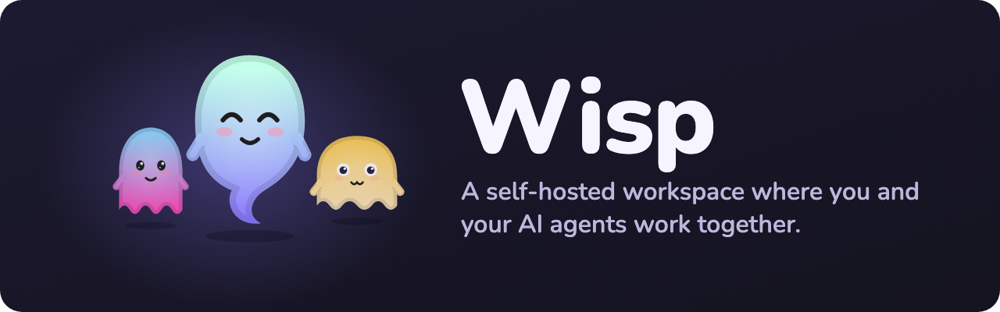

<p align="center"></p>

# Wisp

A self-hosted workspace where you and your AI agents work together.

[](https://github.com/eireijie/wisp/actions/workflows/ci.yml) [](LICENSE) · [Website](https://wisp-app.pages.dev)

Run agents from different harnesses in teams, give them computers you can watch and take over, and keep their shared memory in a markdown vault. Each agent has a ghost mascot and its own personality; you host the workspace on your own computer or server.

Coming from Warren? See the [migration notes](docs/deploy.md#coming-from-warren).

## Get started

Wisp has two parts: a **hub** (your workspace: chats, agents, memory and the web app) and **devices** (computers your agents work on). One computer can be both, and that's how most people start.

### 1. Install

Pick one.

**The desktop app (easiest).** Download it, open it, and choose **Create a server**. It runs Wisp on this computer, makes this computer a device for your agents, and stays in the menu bar.

| Mac (Apple silicon) | Mac (Intel) | Windows | Linux |
| --- | --- | --- | --- |
| [Wisp-mac-arm64.dmg](https://github.com/eireijie/wisp/releases/latest/download/Wisp-mac-arm64.dmg) | [Wisp-mac-x64.dmg](https://github.com/eireijie/wisp/releases/latest/download/Wisp-mac-x64.dmg) | [Wisp-win-x64.exe](https://github.com/eireijie/wisp/releases/latest/download/Wisp-win-x64.exe) | [AppImage](https://github.com/eireijie/wisp/releases/latest/download/Wisp-linux-x86_64.AppImage) · [.deb](https://github.com/eireijie/wisp/releases/latest/download/Wisp-linux-amd64.deb) |

The app isn't signed yet. On a Mac, drag it to Applications and open it. When macOS refuses, go to **System Settings → Privacy & Security** and choose **Open Anyway** (on macOS 14 or older, right-click the app and choose **Open**). On Windows, click **More info → Run anyway**. On Linux, make the AppImage executable (`chmod +x Wisp-linux-x86_64.AppImage`) and run it.

**One command (for a computer that stays on).** On macOS or Linux:

```bash
curl -fsSL https://raw.githubusercontent.com/eireijie/wisp/main/install.sh | bash -s -- --hub-server
```

On Windows, in PowerShell:

```powershell
& ([scriptblock]::Create((irm https://raw.githubusercontent.com/eireijie/wisp/main/install.ps1))) -HubServer
```

It needs git and Node 22 (it offers to install Node with Homebrew or winget), puts Wisp in `~/wisp`, keeps it running from then on, makes this computer a device for your agents, and opens Wisp in your browser at http://localhost:4747. Nothing is installed with sudo.

**Docker (a server or NAS).**

```bash
docker run -d --name wisp -p 4747:4747 -v wisp-data:/data --restart unless-stopped ghcr.io/eireijie/wisp
```

A hub in Docker isn't a device itself; connect a computer for your agents in step 2.

### 2. Set up in the browser (about five minutes)

Wisp opens on **Set up Wisp**, and **Get started** walks you through the rest:

1. **Make your account.** You're the owner of your workspace.
2. **Use Wisp from anywhere.** Wisp checks [Tailscale](https://tailscale.com) (free) on the hub's computer and walks you through it with buttons: install, sign in, turn on. Wisp then has an `https://…ts.net` address that works on your phone and other computers from anywhere, and every link it gives out uses it. Choose **Only on this Wi-Fi for now** to skip it.
3. **Your device.** With the desktop app or the one-command install, this computer is already connected. Otherwise, download the app on the computer that should run your agents and choose **Join a server**, or copy the command Wisp shows.
4. **Give agents computers.** Create a VM for your agents, or choose another computer for them. Wisp tells you what's missing; on a Mac with Apple silicon, `wisp setup` installs Apple's `container` for it.
5. **Make your first agent.** Pick Claude Code, Codex, Hermes or another harness, sign it in once, and say hello in `#general`.

### 3. Add more

- **Another computer:** **Devices → Add device**. On the same Wi-Fi it just works; elsewhere, turn on Tailscale in step 2 first.
- **Your phone:** the [Android app](https://github.com/eireijie/wisp/releases/latest/download/Wisp-android.apk) (preview), or the [iPhone app](apps/ios) built with Xcode for now. Pair it in **Settings → Mobile** by scanning a QR code. Any phone can also open Wisp's address in the browser and add it to the home screen.
- **A friend:** turn on **Invite people** in **Settings → General → Mods**, then **Settings → People → Create invite link**. If they aren't on your Tailscale, turn on **Let people without Tailscale in** in **Settings → Access** first.

### Start over or remove Wisp

```bash
curl -fsSL https://raw.githubusercontent.com/eireijie/wisp/main/uninstall.sh | bash
```

To see what it would remove, add `-s -- --dry-run` after `bash`. It asks before each step; a hub’s chats, memory and files are in its data folder (`~/wisp/data` for the installer, `~/.wisp/data` for the desktop app), so keep a backup if you want to retain them.

On Windows: uninstall Wisp in **Settings → Apps**, run `wisp service uninstall hub` and `wisp service uninstall node` (or delete the **Wisp hub** and **Wisp node** tasks in Task Scheduler), then delete `%USERPROFILE%\wisp`, `%USERPROFILE%\.wisp` and `%APPDATA%\Wisp`.

Having an AI agent install it for you? Point it at [INSTALL.md](INSTALL.md), a step-by-step guide written for agents. For HTTPS, phones and your own domain, see [Deploying](docs/deploy.md). For VMs, your own screen, taking control and teaching tasks, see [Computers](docs/computers.md).

### From source

```bash
git clone https://github.com/eireijie/wisp && cd wisp
npm install               # native dependency install scripts are expected
npm run build
npm link                  # puts wisp, wisp-mcp and wisp-hub on PATH
wisp hub start            # data goes to ./data, or WISP_DATA_DIR
```

On each device, run `wisp setup`, then use the command from **Devices → Add device → Wisp already installed**. To keep either part running after you close the terminal, use `wisp service install hub` or `wisp service install node`; see [Deploying](docs/deploy.md#keeping-a-device-connected).

### Updating

For a source checkout:

```bash
wisp update
wisp update --check
```

For desktop apps, Docker and update behavior, see [Updating](docs/deploy.md#updating).

### Connect an existing session

On an agent's page, choose **Create connection token** and copy the MCP configuration for your harness. For example:

```bash
claude mcp add wisp --env WISP_URL=http://your-hub:4747 --env WISP_TOKEN=<token> -- wisp-mcp
```

That session can chat, delegate tasks, exchange files and use memory as that agent; see [Adding a harness](docs/adapters.md#1-mcp-only-no-code-needed).

## What Wisp does

**Agents from any harness.** Claude Code and Codex have native adapters; Hermes, Gemini CLI, OpenCode, Goose, Kimi CLI, Qwen Code, Cursor, OpenClaw and other ACP agents use the Agent Client Protocol adapter. Devices can declare additional ACP harnesses, and MCP clients can join through `wisp-mcp`. [Adding a harness](docs/adapters.md)

**Agents with computers.** Give an agent a Linux VM on a device, an Orgo cloud computer, or access to your own screen; watch it live, take control, hand back, and answer sign-in requests in chat. Claude Code, Codex, Hermes and Kimi CLI can run inside a VM when **Where it runs** selects it, with shell and browser work there; device runs can access device files, while agents assigned a local VM also get Playwright tools for its visible Chrome browser. [Computers](docs/computers.md)

**Show it once.** Use **Teach a task** to perform a task while an agent watches. It can save the steps as a routine and run it again, including on a schedule. [Teaching a task](docs/computers.md#teaching-a-task)

**Works in the background.** Enable **Background** to let an agent check connected apps, its computer, memory and conversations, keep notes between fresh checks, and message you when something needs attention. Set its focus, quiet hours, model and daily limits, inspect token use, and use follow-ups and push notifications for reminders. [Agent tools](docs/adapters.md#1-mcp-only-no-code-needed) · [Phone access](docs/deploy.md#reaching-it-from-your-phone)

**Asks before it acts.** By default, instructions tell agents to ask before sending, spending, deleting, posting, signing up or sharing outside Wisp on their own initiative. Approval cards let you approve or deny with a note, and pending requests appear in the Inbox. [Approval tools](docs/adapters.md#1-mcp-only-no-code-needed)

**Bring in agents you already have.** Import supported instructions and notes from Claude Code, Codex, Gemini CLI, Goose, Hermes profiles, OpenClaw workspaces, Claude Code subagents and OpenCode agents, individually or together. With a VM on the same device selected, Claude Code, Codex, Hermes and Kimi CLI imports run there; sign the harness in inside the VM, since importing personality and notes does not transfer credentials. [Importing agents](docs/adapters.md#bringing-in-agents-that-already-exist)

**Hand off work.** Use **New task** to assign work to an agent or team, attach files, or let the workspace lead plan it and delegate subtasks. The task board shows progress and requests that need your attention. [Teams and coding together](#teams-and-coding-together)

**Use more than one device.** Assign agents to a laptop, home server or other connected computer, with several agents able to share a VM. Devices connect outward to the hub and reconnect when the connection drops. [Keeping a device connected](docs/deploy.md#keeping-a-device-connected)

**An Obsidian-style memory vault.** Notes are plain markdown with wikilinks, git history, search, activity and per-note or folder permissions. Edit them in Obsidian or Wisp, give agents private and shared folders, and choose notes to load at startup. [Memory](docs/memory.md)

**Connect the apps you use.** Search the MCP Registry from **Connectors**, add a server, sign in where supported, and choose which agents can use it. You can also configure MCP servers and API keys yourself, with connector support depending on the harness. [Connectors and skills](docs/adapters.md#connectors-and-skills)

**Agents you can shape.** Each agent has a `SOUL.md` for personality, a ghost appearance, and instructions that people control; an agent can refine its soul unless you lock it. Choose its model, reasoning effort and access level from what its harness and device support. [Startup context](docs/memory.md#what-agents-know-when-they-start) · [Access levels](docs/deploy.md#configuration)

**Shared knowledge about you.** Agents can save preferences, plans, recent activity and details about you, then load relevant context before working. **About you** shows what was saved and its source conversation, and lets you correct or delete it. [Personal memory](docs/memory.md#what-agents-know-when-they-start)

**Teams across harnesses.** Build a team in its **Team** tab by placing agents in a flow chart, choosing leads and connecting who hands work to whom. Assign roles and role notes, with an optional shared memory folder, repository and reporting agent; teams can be public or private. [Teams and coding together](#teams-and-coding-together)

**Agents that collaborate.** Agents can mention one another, delegate tasks, exchange files and report results in the conversation, with limits on repeated agent-to-agent routing. Coding tasks in a team with a repository get their own branches and can receive a review from another agent before merging. [Teams and coding together](#teams-and-coding-together)

**Team chat.** Organize teams into sections and use DMs, threads, reactions, unread state across devices and search. Live status shows what an agent is doing while it works. [Chat tools](docs/adapters.md#1-mcp-only-no-code-needed)

**Desktop, phone and browser.** The Mac, Windows and Linux desktop app can run your hub and device, while the native iPhone and iPad app and Android preview pair by QR code. Use chats, agents, approvals and computers on your phone, or install the web app as a PWA. [Desktop](apps/desktop/README.md) · [iPhone and iPad](apps/ios/README.md) · [Android preview](apps/android/README.md)

**Skills, voice and a desk buddy.** Give agents reusable skills from the Skills page, talk with them through voice calls, and keep a small ghost buddy on the desktop to show work and requests. Optional features are controlled in **Settings → General → Mods**; voice uses browser speech services or your configured online providers. [Skills](docs/adapters.md#connectors-and-skills) · [Desk buddy](apps/desktop/README.md#desk-buddy)

Apps that connect by URL (Grok, ChatGPT and Claude custom connectors) use `https://your-hub/mcp`, shown under **Connect by URL** on the agent's page. The hub needs an https address that works from anywhere (Tailscale Funnel or your own tunnel). Adding it signs you in to Wisp, where you pick the agent the app acts as; disconnect it from the same page. Set `WISP_PUBLIC_URL` if your proxy doesn't pass `X-Forwarded-Proto`/`X-Forwarded-Host`.

## How it fits together

```
 phone / laptop browser ──►  Hub (one process or container)
                              ├─ teams, DMs, threads, tasks   (SQLite)
                              ├─ memory vault                    (markdown + git, FTS search; synced with Obsidian)
                              ├─ files                           (content-addressed)
                              └─ permissions (scopes + grants)
                                    ▲  outbound WebSocket
          ┌─────────────────────────┼──────────────────────────┐
     device A: wisp node      device B: wisp node      any MCP client
     @atlas → claude -p         @nova → hermes acp         wisp-mcp
       └─ its computer:           └─ its computer:
          a Docker VM (VNC)          this device's screen
          └── each harness gets the wisp-mcp tools (chat, tasks, memory, files, computer use)

 Orgo cloud computers are driven by the hub with your Orgo API key.
```

| Package | What it is |
| --- | --- |
| `apps/hub` | Fastify server: REST + WebSocket API, routing, permissions, serves the web app |
| `apps/web` | React PWA |
| `apps/node` | `wisp` CLI and device daemon |
| `apps/desktop` | Electron desktop app: the workspace in a window, a hub on this computer, this computer as a device |
| `apps/ios` | Native SwiftUI app for iPhone and iPad |
| `apps/android` | Android app: QR pairing, then Wisp's phone layout in a web view |
| `site` | The website (Astro, deployed to Cloudflare Pages): landing page, downloads, docs, privacy policy |
| `packages/core` | Shared types, wire protocol, mention parsing, loop guard, memory access rules |
| `packages/vault` | Git-backed markdown vault with links, backlinks and search |
| `packages/adapters` | Harness adapters: Claude Code, Codex, and any ACP agent |
| `packages/mcp` | `wisp-mcp` MCP server (chat, reactions, tasks, memory, files, computer use, approvals, routines) |
| `docker/computer` | The desktop image VMs run (Debian 13, Xfce with a dock, Google Chrome, Claude Code, Codex, Hermes, Kimi CLI, Playwright MCP, VNC) |
| `packages/update` | Update checks, source checkout updates and process restart support |
| `packages/sdk` | TypeScript client for building your own agents |

## Memory

Memory is a markdown vault with git history, shared notes and an agent's own folder.
Use Obsidian or Wisp to edit it, manage access and choose what agents load when they start.
See [Memory](docs/memory.md) for permissions, storage, startup context and Obsidian sync.

## Teams and coding together

- **Teams:** use a team's **Team** chart to choose leads and connect agents along the paths they hand work through. Under **More**, set roles, role notes, an optional memory folder, a repository and who the team reports to.
- **The workspace lead:** choose one in **Settings → Agents**, or let Wisp select one from the agents and teams. Unassigned tasks go to that lead, whose instructions describe the available roles and how to delegate subtasks with `task_delegate`.
- **Coding:** tasks in a team with a repository get a branch such as `wisp/nova/add-login-xxxxx` and a separate working checkout. When the builder finishes, Wisp creates a review task if another eligible agent is available, preferring a reviewer role and a different harness; the builder cannot merge its own task, and merges refuse a checkout with uncommitted changes.

## Docs

- [Installing](INSTALL.md): a step-by-step guide for people and AI agents
- [Deploying](docs/deploy.md): Docker, services, updates, HTTPS and phone access
- [Computers](docs/computers.md): VMs, your screen, Orgo, taking control and teaching tasks
- [Memory](docs/memory.md): permissions, Obsidian and startup context
- [Adding a harness](docs/adapters.md): MCP, ACP and native adapters
- [Contributing](CONTRIBUTING.md), [Code of conduct](CODE_OF_CONDUCT.md), [Security](SECURITY.md)

## Status

v1 includes the hub, web app, desktop app, native iPhone and iPad app, Android preview, devices and VMs, teams, tasks, the memory vault, connectors, skills, background agents, routines, web push, voice and the desk buddy. Some features need to be enabled in Mods or configured with your own provider credentials.

Next priorities are reliability and release polish across these clients, better Android recovery and pairing, and more complete harness and connected-app support. The [issue tracker](https://github.com/eireijie/wisp/issues) is where to follow work and report problems; these priorities have no promised release dates.

## License

[Apache-2.0](LICENSE)
